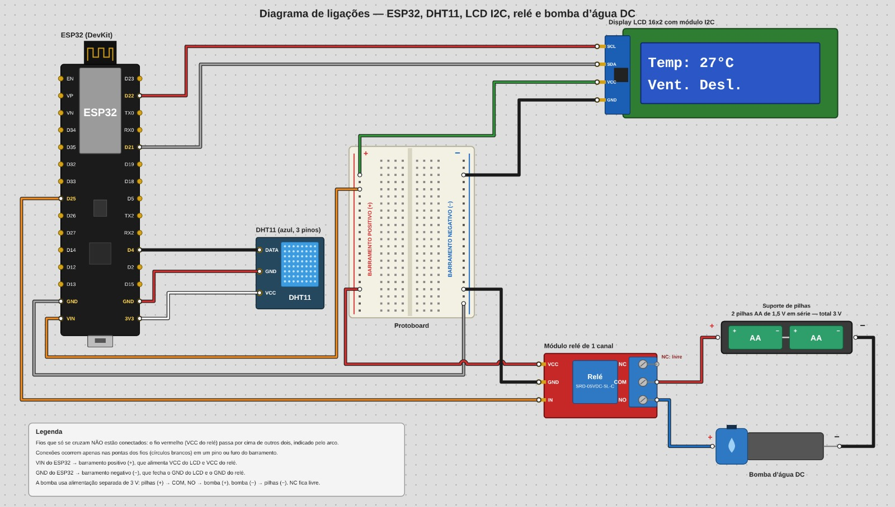

# 🌱 SmartBerry360° — IoT


## 📖 Sobre o projeto

O SmartBerry360° é um sistema de monitoramento e automação de
estufas inteligentes, desenvolvido com o objetivo de aplicar
tecnologias de Internet das Coisas (IoT) à agricultura.

Este repositório é responsável pelo firmware embarcado no ESP32,
realizando a comunicação com sensores, o acionamento de atuadores,
o processamento de dados ambientais e a disponibilização de
uma interface web para monitoramento e controle da estufa.

## 🚀 Funcionalidades

### Monitoramento ambiental

- Leitura de temperatura em tempo real.
- Atualização das informações a cada 2,5 segundos.
- Exibição da temperatura e do estado da ventilação em display LCD.

### Irrigação

- Acionamento manual da bomba de água.
- Agendamento diário de irrigação.
- Configuração do horário de acionamento.
- Configuração da duração entre 1 e 300 segundos.
- Desligamento automático após o período definido.
- Proteção contra execuções repetidas do mesmo agendamento.

### Ventilação

- Acionamento manual da ventilação.
- Controle automático por temperatura.
- Temperatura máxima configurável entre 10°C e 60°C.
- Ativação automática ao salvar uma nova temperatura máxima.
- Histerese de 1°C para evitar acionamentos repetitivos do relé.

### Conectividade e armazenamento

- Comunicação por rede Wi-Fi.
- Servidor web hospedado no próprio ESP32.
- Limite de 15 segundos para conexão inicial.
- Reconexão automática em caso de perda de conexão.
- Funcionamento local independente da conexão Wi-Fi.
- Sincronização de horário por NTP ou pelo navegador.
- Armazenamento permanente das configurações na memória do ESP32.

## 🛠️ Tecnologias utilizadas

| Tecnologia | Finalidade |
| --- | --- |
| ESP32 | Processamento e controle dos dispositivos |
| Arduino IDE | Desenvolvimento e gravação do firmware |
| C/C++ | Programação do sistema embarcado |
| HTML5 | Estrutura da interface web |
| CSS3 | Estilização da interface |
| JavaScript | Interatividade e atualização dos dados |
| JSON | Comunicação e troca de informações |
| Wi-Fi | Comunicação em rede local |
| NTP | Sincronização de horário |
| Preferences | Armazenamento não volátil |

## 🔌 Componentes eletrônicos

- ESP32 DevKit (ESP32-WROOM-32).
- Sensor de temperatura DHT.
- Display LCD 16x2 com módulo I2C.
- Módulos de relé de 5V.
- Bomba de água DC.
- Ventilador para circulação de ar.
- Protoboard.
- Fios jumper.
- Suporte para duas pilhas AA de 1,5V.

## 📐 Diagrama elétrico

O diagrama abaixo representa as conexões entre o ESP32,
o sensor de temperatura, o display LCD I2C, o módulo de
relé e a bomba de irrigação.

<p align="center">
  
</p>

A bomba de água possui alimentação independente, composta
por duas pilhas AA de 1,5V em série, totalizando 3V.

O relé é responsável por controlar o acionamento da bomba,
sem alimentá-la diretamente pelos pinos do ESP32.

> O diagrama representa o circuito de monitoramento e irrigação.
> O circuito da ventilação não está representado nesta imagem.
> A imagem identifica um DHT11, enquanto o firmware atual
> está configurado para o DHT22.

## 📍 Mapeamento dos pinos

| Componente | Pino ESP32 |
| --- | --- |
| Relé da bomba de irrigação | GPIO25 |
| Relé da ventilação | GPIO27 |
| Sensor DHT — DATA | GPIO4 |
| Display LCD — SDA | GPIO21 |
| Display LCD — SCL | GPIO22 |
| Alimentação dos módulos de 5V | VIN |
| Alimentação do sensor DHT | 3V3 |
| Aterramento | GND |

### Configuração dos relés

| Atuador | Ligado | Desligado |
| --- | --- | --- |
| Bomba de irrigação | HIGH | LOW |
| Ventilação | LOW | HIGH |

## 📚 Bibliotecas utilizadas

```cpp
#include <WiFi.h>
#include <WebServer.h>
#include <DHT.h>
#include <LiquidCrystal_I2C.h>
#include <Preferences.h>
#include <time.h>
#include <sys/time.h>
#include <math.h>
```

As bibliotecas externas necessárias podem ser instaladas
pelo Gerenciador de Bibliotecas do Arduino IDE:

- DHT sensor library — Adafruit.
- Adafruit Unified Sensor.
- LiquidCrystal I2C.

As demais bibliotecas acompanham o ambiente de
desenvolvimento e o pacote de suporte ao ESP32.

## 🖥️ Interface web

O ESP32 disponibiliza uma interface web responsiva,
desenvolvida com base na identidade visual do aplicativo
SmartBerry360°.

Por meio do painel, o usuário pode:

- Visualizar a temperatura atual.
- Verificar o estado de conexão do dispositivo.
- Ligar e desligar a irrigação.
- Ligar e desligar a ventilação.
- Configurar a temperatura máxima.
- Ativar ou desativar a ventilação automática.
- Agendar a irrigação.
- Consultar o relógio sincronizado do ESP32.

## 🔗 Endpoints da API embarcada

| Método | Endpoint | Descrição |
| --- | --- | --- |
| GET | `/` | Interface web |
| GET | `/api/state` | Estado atual do sistema |
| GET | `/api/toggle?device=pump` | Alterna o estado da bomba |
| GET | `/api/toggle?device=vent` | Alterna o estado da ventilação |
| POST | `/api/settings` | Configura temperatura e modo automático |
| POST | `/api/schedule` | Configura o agendamento da irrigação |
| POST | `/api/time` | Sincroniza o relógio do ESP32 |

## ⚙️ Como executar o projeto

### 1. Configurar o ambiente

- Instale o Arduino IDE.
- Instale o pacote ESP32 by Espressif Systems.
- Instale as bibliotecas necessárias.
- Abra o arquivo `SmartBerry360.ino`.

### 2. Configurar a rede Wi-Fi

Altere as credenciais de rede presentes no código:

```cpp
const char* ssid = "NOME_DA_REDE";
const char* password = "SENHA_DA_REDE";
```

### 3. Enviar o firmware

- Conecte o ESP32 ao computador por USB.
- Selecione a placa ESP32 Dev Module.
- Selecione a porta COM correspondente.
- Compile e envie o código.

### 4. Acessar o sistema

Abra o Monitor Serial com velocidade de 115200 baud.

Após estabelecer a conexão Wi-Fi, o ESP32 apresentará
o endereço IP do servidor web.

Acesse esse endereço pelo navegador de um dispositivo
conectado à mesma rede.

## 📂 Estrutura do repositório

```text
SmartBerry-IoT/
├── SmartBerry360/
│   └── SmartBerry360.ino
├── docs/
│   └── SmartBerry_IoT.jpeg
└── README.md
```

## 📋 Status do desenvolvimento

- [x] Comunicação com o ESP32.
- [x] Monitoramento de temperatura.
- [x] Comunicação com display LCD.
- [x] Controle manual da irrigação.
- [x] Controle manual da ventilação.
- [x] Ventilação automática por temperatura.
- [x] Agendamento diário de irrigação.
- [x] Interface web responsiva.
- [x] Reconexão automática de Wi-Fi.
- [x] Armazenamento permanente das configurações.
- [x] Sincronização de horário.
- [ ] Monitoramento de umidade pela interface.
- [ ] Histórico de dados ambientais.
- [ ] Integração com a API Spring Boot.
- [ ] Integração com o aplicativo Android.
- [ ] Autenticação e segurança dos endpoints.

## ⚠️ Observações

- O servidor web foi desenvolvido para utilização em rede
  local controlada e ainda não possui autenticação.
- Após uma perda total de alimentação, o ESP32 precisa
  sincronizar novamente seu relógio para executar agendamentos.
- As configurações de automação permanecem salvas após
  reinicializações.
- Os atuadores devem utilizar alimentação adequada.
- Os GPIOs do ESP32 operam com sinais de 3,3V.
  Utilize módulos compatíveis ou conversores de nível lógico.

---

<p align="center">
  <strong>🌱 SmartBerry360°</strong><br>
  Tecnologia & Agricultura<br>
  Gestão inteligente para sua estufa.
</p>
